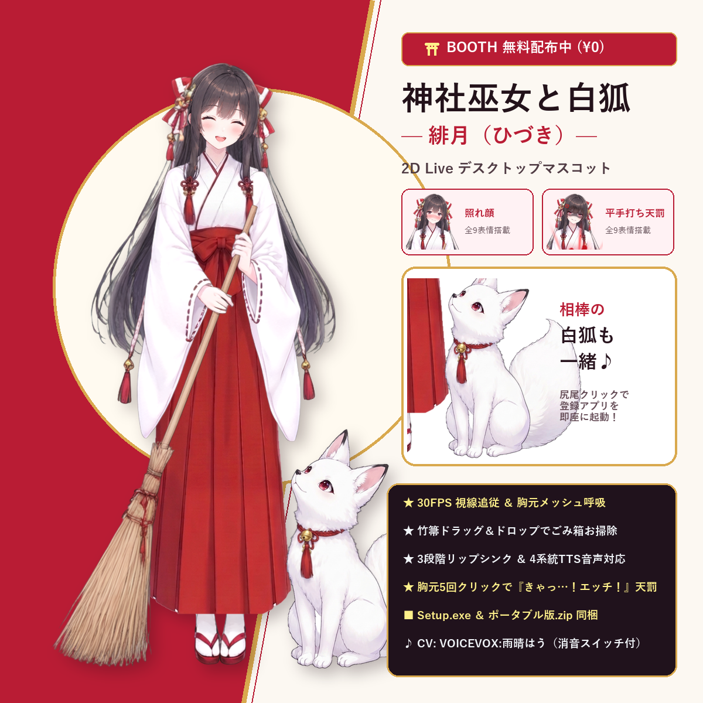

<div align="center">

# ⛩️ Shrine Maiden & Little White Fox — Hidzuki (緋月)
### Embodied 2D Live Physics & AI Desktop Companion for Windows 10 / 11 (100% English Edition)

[](https://github.com/pathetic777/Miko-Fox-2DLive-AI-Desktop-Companion/stargazers)
[](https://github.com/pathetic777/Miko-Fox-2DLive-AI-Desktop-Companion/releases/latest)
[](https://youtu.be/t9AHTPpDL8Y)
[](https://nocturne-live2d.booth.pm/items/9075455)

> 🌟 **Enjoying Hidzuki & Little White Fox? Please click the ⭐ Star button at the top-right of this repository!**  
> Your Star & Upvote helps more anime & AI lovers discover Hidzuki and keeps free open-source updates alive!

<p align="center">
  
  
</p>

🎬 **Watch the Official Demo PV on YouTube:** [**https://youtu.be/t9AHTPpDL8Y**](https://youtu.be/t9AHTPpDL8Y)

</div>

---

## ✨ Why Hidzuki Is Different (Commercial-Grade 2D Live + Real Windows OS Actions)

Most desktop mascots only play a looped idle animation on your screen. **Hidzuki (緋月)** and her **Little White Fox** are built with a custom **64×64 real-time mesh deformation engine** and **native Win32 physical interactions**—bringing commercial-grade quality completely **free & open-source**:

1. **🧹 Drag & Drop Any File onto Her Bamboo Broom → Sweeps into Recycle Bin!**
   - Drag any unwanted desktop file or folder onto Hidzuki's bamboo broom (or drop a file into the Windows Recycle Bin next to her).
   - Her sleeves, tassels, and bamboo bristles deform smoothly as she **sweeps twice (`Swish, swish...!`)** with authentic bamboo broom sound effects and moves the file safely into the Windows Recycle Bin!
2. **🦊 Click the Little White Fox's Fluffy Tail → Wags & Launches Your Favorite App!**
   - Bind any `.exe`, `.lnk` shortcut, `.bat` script, or website URL to the Little White Fox's tail.
   - Clicking its tail makes the fox wag happily twice while Hidzuki switches to **`④ Loving Heart Eyes`** and launches your app!
3. **👀 30 FPS Global Mouse Gaze Tracking + Chest Breathing + 3-Stage Lip-Sync**
   - Her full-oval irises smoothly track your mouse cursor anywhere across your monitors at 30 FPS while her chest gently breathes and her mouth lip-syncs in 3 stages (`closed` → `half-open` → `open`) whenever she speaks!
4. **🎭 Dual-Channel AI Brain + Automatic 9-Expression Switching (`MVU Engine`)**
   - Even **without an API key**, Hidzuki works right out of the box with built-in contextual replies and physical interactions.
   - When connected to a **Free Local LLM (Ollama)** or **Free Cloud API (Google Gemini)**, our decoupled **2-Channel MVU Architecture** generates clean dialogue on Channel 1 while Channel 2 automatically switches Hidzuki's face across **all 9 expressions**:
     - `① Gentle Smile` • `② Beaming Smile` • `③ Starry Pride` • `④ Loving Heart Eyes` • `⑤ Shy Blush` • `⑥ Flinching Bashful` • `⑦ Pouty Angry` • `⑧ Teary Grievance` • `⑨ Darkened Wrath`
5. **⚡ 5-Click Chest Poke Easter Egg ("Divine Slap & 20s Shutdown Punishment")**
   - Poking her chest 1 to 4 times triggers escalating bashful/pouting/teary warnings (`⑤` → `⑥` → `⑦` → `⑧`).
   - On the **5th click**, she switches to **`⑨ Darkened Wrath`**, plays the built-in bonus voice (`"Kyaa...! Ecchi!"` + crisp slap sound + crimson 5-finger slap mark), and initiates a **20-second Windows Shutdown/Restart countdown**!
   - *(Don't worry: a bright green **`🛑 I'm sorry!! (Abort Shutdown)`** mercy button appears immediately so you can cancel with one click!)*

---

## 📦 One-Click Download & Installation (No Python Required!)

Go to the [**GitHub Releases Page**](https://github.com/pathetic777/Miko-Fox-2DLive-AI-Desktop-Companion/releases/latest) and download either:
- **`Hidzuki_Miko_Fox_2DLive_Desktop_Companion_EN_Setup.exe`** — One-click Windows GUI Setup Wizard (creates Desktop shortcut & optional Windows Startup auto-run).
- **`Hidzuki_Miko_Fox_2DLive_Desktop_Companion_EN_Portable.zip`** — Portable no-install edition (just unzip and run `MikoFoxPet.exe`!).

---

## 🧠 How to Connect a 100% Free AI Brain (Beginner-Friendly Guide)

Right-click Hidzuki on your desktop and select **`⚙️ Open Web Control Panel`** (`http://127.0.0.1:18766/pet`). Look at **Box 2 (`🔌 API & Voice Settings`)**:

### Option A: Standard / Low-Spec PC (No GPU Needed) — **Free Google Gemini API**
1. Visit [**Google AI Studio**](https://aistudio.google.com/app/apikey) and sign in with your Google account to claim a **free API Key** in 30 seconds.
2. In Hidzuki's Web Control Panel (`Box 2`), click **`✨ Preset: Free Google Gemini`**.
   - **API URL Endpoint**: `https://generativelanguage.googleapis.com/v1beta/openai`
   - **Model Name**: `gemini-2.5-flash`
3. Paste your API Key and click **`💾 Save API & Voice Settings`**.

### Option B: Gaming / High-Spec PC (Dedicated GPU) — **100% Offline Local LLM via Ollama (`Qwen` / `Gemma`)**
1. Download and install [**Ollama**](https://ollama.com/).
2. Open PowerShell or Command Prompt and pull a lightweight local model:
   ```bash
   ollama run qwen2.5:7b
   # or:
   ollama run gemma3
   ```
3. In Hidzuki's Web Control Panel (`Box 2`), click **`💻 Preset: Local Ollama (Qwen/Gemma)`**, click **`🔄 Fetch Models`**, and click **`💾 Save API & Voice Settings`**!

---

## 🛠️ Run from Source Code (For Developers)

```bash
pip install pillow numpy
python miko_desktop_pet_app.py
```

---

## 💝 Support the Developer & Custom Commissions

Although **Hidzuki** is released **100% free & open-source**, she was crafted with the same multi-layer rigging, physics deformation, and OS integration as paid commercial desktop companions.

- ⭐ **Star & Share**: Please give this repository a **⭐ Star** on GitHub!
- ⛩️ **BOOTH Supporter / O-saisen Edition (`¥300 JPY`)**:
  - [**Free ¥0 BOOTH Page**](https://nocturne-live2d.booth.pm/items/9075455)
  - [**¥300 Shrine Offering (O-saisen) Supporter Edition on BOOTH**](https://nocturne-live2d.booth.pm/items/9075304)
  - [**Previous Work: 4-Stage Transformation Shrine Maiden 2D Live (`¥200`)**](https://nocturne-live2d.booth.pm/items/9067736)
- 🎨 **Custom 2D Live / AI Desktop Mascot Commissions**:
  - Want to turn your own OC, VTuber model, or anime illustration into an interactive physics-rigged 2D Live AI desktop companion?
  - 📩 **Contact Email**: [**wm2841944156@gmail.com**](mailto:wm2841944156@gmail.com)

---

## 📜 Credits & License
- **Built-in Bonus Voice** (`"Kyaa...! Ecchi!"` 1 line only): `VOICEVOX:Amahare Hau (雨晴はう)` — can be toggled ON/OFF with one click in the right-click menu or Web Control Panel.
- **License**: MIT License (Code) / Free for personal desktop use.
